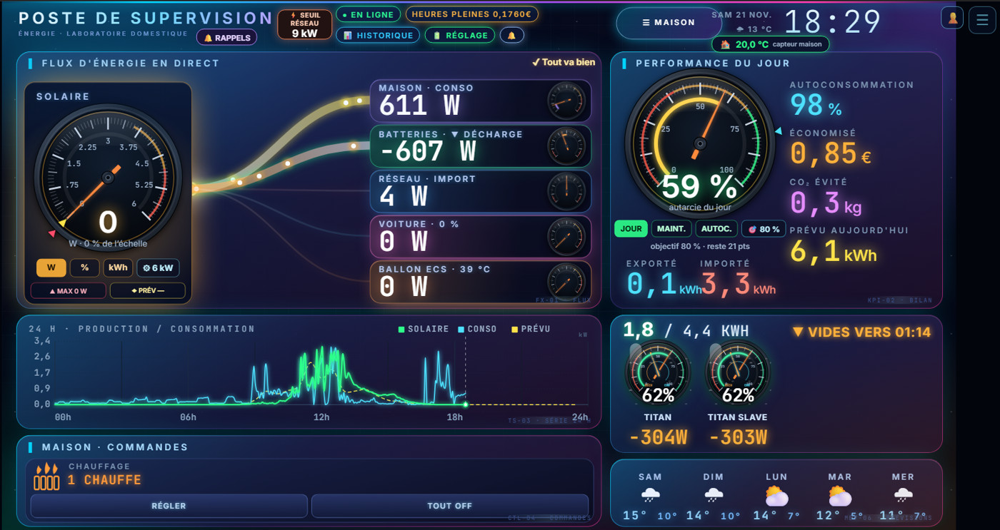

# ha-energie-dashboard-izypower

Tableau de bord énergie plein écran pour **Home Assistant**, adapté aux batteries **Izypower Titan** (1 à 4 batteries) : flux d'énergie en direct, performance du jour, courbe 24 h, batteries, heures creuses, prévisions Solcast, commandes et assistant.



> **Basé sur [ha-energie-dashboard](https://github.com/tazzdel/ha-energie-dashboard) de tazzdel**, adapté et partagé avec son accord écrit. Merci à lui pour le design et la base du projet.

**Démarrage rapide :** copiez `energie.html` dans `/config/www/`, ajoutez une carte iframe `url: /local/energie.html?v=1`, ouvrez le tableau de bord. Tout est détecté automatiquement. Détails ci-dessous.

Tableau de bord plein écran (flux d'énergie en direct, performance du jour, courbe 24 h, batteries, commandes, météo).
Pensé pour un écran dédié (tablette murale, TV, mini-PC), en 1600 × 900.

## Crédits

- **Dashboard d'origine : « ha-energie-dashboard » de tazzdel** — https://github.com/tazzdel/ha-energie-dashboard
  Tout le mérite du design et de la base revient à son auteur.
- Cette version est une **adaptation pour les batteries Izypower Titan**, partagée **avec l'accord écrit de tazzdel**.
- Pas de licence ouverte : merci de **toujours citer l'auteur d'origine avec le lien**, et de ne pas présenter ce travail comme le vôtre.
- Aucune affiliation avec Izypower ni avec Home Assistant. Marques citées à titre d'information uniquement.

## Ce qui change par rapport à l'original

- **Batteries Izypower Titan** : détection automatique (niveau, puissance, température), jusqu'à 4 batteries. Réglage manuel possible si besoin.
- **Seuils mini / maxi de batterie** : détectés automatiquement (entités `number.cluster_…`), réglables depuis l'onglet Batteries avec le bouton **Appliquer**.
- **Heures creuses à plusieurs plages** (ex. nuit + après-midi) : `HC_PLAGES`.
- **Capteur de consommation réelle de la maison** (optionnel) : `HOUSE_SENSOR`.
- **Borne de recharge** : détection corrigée (les capteurs de puissance des batteries ne sont plus pris pour la borne).
- **Alerte Solcast** : les capteurs optionnels (jours 3 à 7, précision, amortissement) ne déclenchent plus de fausse alerte.
- Les tuiles Portail / Garage / Volets ne sont plus affichées ; il reste Scénarios, Chauffage et Batteries.

## Installation

1. Copiez `energie.html` dans `/config/www/` (créez le dossier `www` s'il n'existe pas ; il se lit par `/local/`).
   Pour le partage Samba : `\\IP_DE_HOME_ASSISTANT\config\www\energie.html`.
2. Dans un tableau de bord, ajoutez une carte **Manuelle** :
   ```yaml
   type: iframe
   url: /local/energie.html?v=1
   aspect_ratio: 56%
   ```
   Pour un affichage plein écran, utilisez une vue en mode **Panneau** avec cette seule carte.
3. À chaque nouvelle version du fichier, changez `?v=1` en `?v=2`, `?v=3`… pour vider le cache.
4. Ouvrez la page **dans Home Assistant** (via la carte iframe). Si vous ouvrez directement `/local/energie.html` dans le navigateur, le dashboard reste en **mode démonstration** (valeurs fictives).

## Configuration (en général : aucune)

Tout est cherché automatiquement : solaire, réseau, batteries Titan, borne de recharge, ballon d'eau chaude, prévisions Solcast, météo.
Pour forcer un capteur, ouvrez le fichier avec un éditeur de texte et cherchez **ENTITÉS** :

| Réglage | Rôle |
|---|---|
| `E.pv`, `E.grid`, `E.ev`, `E.ecs` | capteurs de puissance solaire, réseau, voiture, ballon (laisser `''` = auto) |
| `UN` | liste des batteries (laisser vide = auto). Exemple en commentaire dans le fichier |
| `BATSET` | entités de seuil mini / maxi si la détection échoue |
| `HOUSE_SENSOR` | capteur de consommation réelle de la maison (vide = calculée) |
| `PACKS`, `KWH_PACK` | nombre de packs par appareil et capacité d'un pack (4,02 kWh pour une Titan) |
| `TARIF_HP`, `TARIF_HC` | prix du kWh en heures pleines / creuses |
| `HC_PLAGES` | heures creuses, une ou plusieurs plages, ex. `[['01:04','06:34'],['14:34','17:04']]` |
| `INVERT_BAT`, `INVERT_GRID` | à passer à `true` si le sens de la puissance est inversé |
| `PV_MAX` | puissance maximale de vos panneaux, pour l'échelle de la jauge |

## Prérequis

- Home Assistant avec vos capteurs Titan disponibles (niveau en %, puissance en W, température). Le niveau est détecté sur les capteurs nommés `…pile_average`, la puissance sur `…ac_input_and_output`.
- Optionnel : intégration Solcast pour les prévisions, une entité `weather.`, un capteur de température de la maison.

## En cas de problème

- **Mode démo / valeurs fixes** : la page n'est pas ouverte dans Home Assistant (voir étape 4), ou le cache garde l'ancienne version (changez `?v=`).
- **Batteries en trop ou à 0 W** : renseignez `UN` à la main (exemple dans le fichier).
- **Sens de la puissance inversé** : `k:-1` sur la batterie concernée, ou `INVERT_BAT=true`.
- **« NON TROUVÉ » sur les seuils** : indiquez `BATSET` avec vos entités `number.` de seuil mini et maxi.
- **Une alerte « capteur hors ligne »** : cliquez dessus pour voir lequel. Un capteur réellement indisponible dans Home Assistant est signalé volontairement.
- **Le bouton Appliquer** modifie vraiment les seuils de vos batteries : bougez les curseurs, puis validez.

## Responsabilité

Fichier fourni tel quel, sans garantie. Vous réglez vos batteries sous votre responsabilité ; testez d'abord avec un petit changement.

## English (short)

Full-screen energy dashboard for Home Assistant, adapted for **Izypower Titan** batteries (1 to 4 units). It is an adaptation of [tazzdel/ha-energie-dashboard](https://github.com/tazzdel/ha-energie-dashboard), shared with the original author's written permission. Copy `energie.html` to `/config/www/`, add an iframe card pointing to `/local/energie.html?v=1`. Sensors (solar, grid, Titan batteries, EV charger, Solcast, weather) are auto-discovered; manual overrides are in the `ENTITÉS` section of the file. Not affiliated with Izypower.

## Droits d'utilisation

Le dashboard d'origine est de **tazzdel** et n'est pas publié sous licence ouverte. Cette adaptation est partagée avec son accord écrit, à condition de **citer l'auteur d'origine avec le lien** vers son dépôt. Merci de ne pas la présenter comme votre propre travail. Pour tout autre usage (redistribution, modification publique), voyez avec l'auteur d'origine.

Adaptation : Biwaire.
